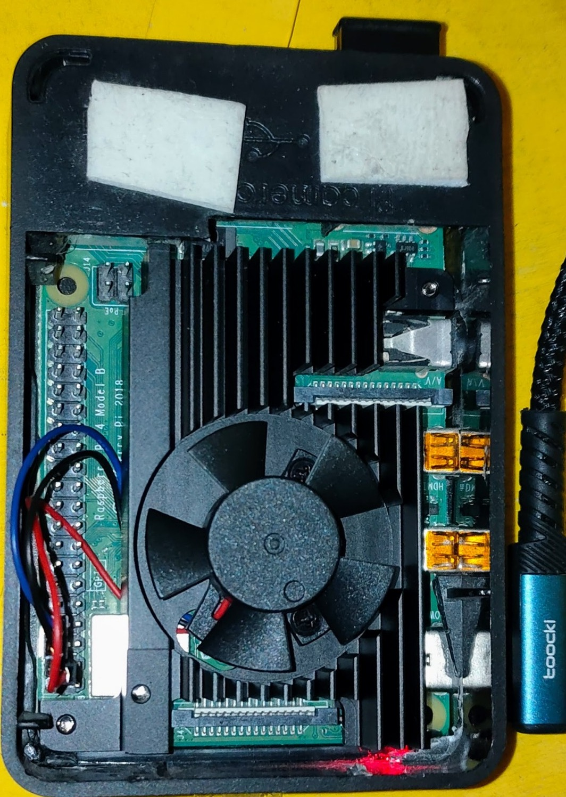

# AI Systems Learning Lab

Experimentos públicos y notas técnicas sobre **IA local, Raspberry Pi, refrigeración, observabilidad y aprendizaje de sistemas**.

## Serie destacada · Raspberry Pi, refrigeración e inferencia local

Una línea de trabajo sobre **cómo se comporta una Raspberry Pi 4B cuando pasa de estar bien refrigerada a ejecutar modelos de lenguaje localmente**: montaje, ruido, temperatura, picos, recuperación y límites de medición.

### Índice actual de la serie

| Artículo | Tema principal |
| --- | --- |
| [Raspberry Pi 4 + Noctua: montaje, alimentación y acústica](experiments/raspberry-pi-noctua-phase1/README.md) | Diseño mecánico, alimentación, ruido y alternativas de disipación |
| [¿Cuánto se calienta una Raspberry Pi ejecutando IA?](experiments/raspberry-pi-edge-inference-thermal/README.md) | Inferencia local, picos térmicos, recuperación y límites de observación |

**Regla editorial de mantenimiento:** cada vez que se publique un nuevo artículo público de esta serie, este índice debe actualizarse con una línea nueva y una descripción breve, manteniendo el conjunto compacto y legible.

## Qué encontrarás en el repositorio

- **Artículos técnicos** orientados a lectura humana, con contexto y conclusiones.
- **Figuras y datos derivados** cuando son publicables.
- **Scripts reproducibles** para regenerar gráficos o apoyar la revisión.
- **Notas exploratorias** sobre sistemas pequeños ejecutando cargas reales de IA.

## Criterio editorial

Este repositorio prioriza piezas públicas **útiles, verificables y contenidas**. Cuando una evidencia no permite una conclusión fuerte, el artículo lo dice explícitamente.
