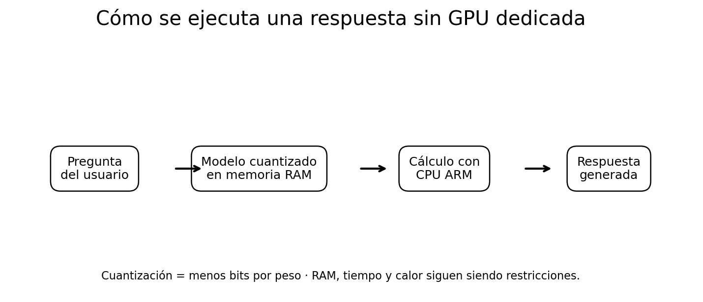
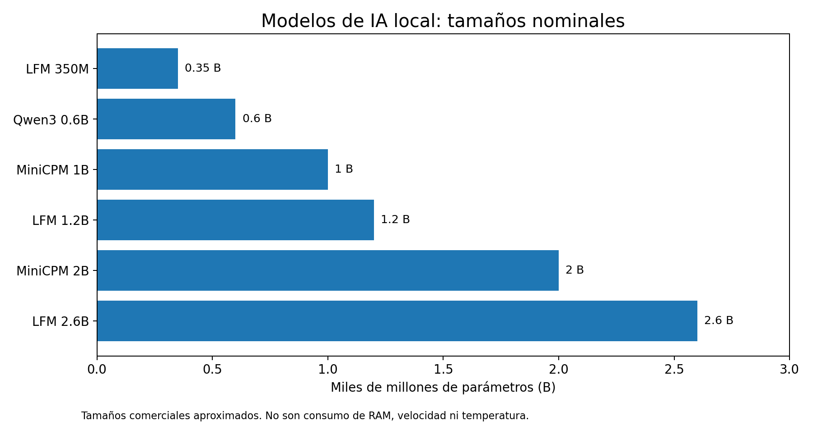

# 1. Una Raspberry Pi sin GPU dedicada para IA

[← Índice](README.md) · [Siguiente: método →](02-como-medimos.md)

## ¿Cómo puede generar texto un ordenador tan pequeño?

La **Raspberry Pi 4B Rev 1.2**, con procesador ARM de cuatro núcleos, puede ejecutar modelos compactos mediante inferencia optimizada para CPU. Aunque la placa incorpora una GPU para gráficos, **estas pruebas se realizaron sobre la CPU**, sin acelerador dedicado de inferencia. La memoria de trabajo también limita qué modelos se pueden cargar y con qué contexto.

Un formato de pesos cuantizados reduce los bits necesarios para almacenarlos. Eso facilita ejecutar algunos modelos en una placa con memoria limitada, pero **cuantización, memoria requerida, velocidad y calidad no son equivalentes**.

## Los modelos empleados

En la exploración aparecieron seis tamaños nominales: LFM 350M, Qwen3 0.6B, MiniCPM 1B, LFM 1.2B, MiniCPM 2B y LFM 2.6B. Hubo **dos cuantizaciones del modelo LFM 1.2B**, por lo que seis tamaños no equivalen a seis únicos ejecutables ni a seis condiciones idénticas.

| Familia / variante nominal | Tamaño aproximado | Precaución |
| --- | ---: | --- |
| Liquid AI LFM 350M | 0,35 B | Tamaño comercial |
| Qwen3 0.6B | 0,6 B | Tamaño comercial |
| MiniCPM 1B | 1 B | Tamaño comercial |
| Liquid AI LFM 1.2B | 1,2 B | Varias cuantizaciones |
| MiniCPM 2B | 2 B | Tamaño comercial |
| Liquid AI LFM 2.6B | 2,6 B | Tamaño comercial |

**B = mil millones de parámetros**, no miles de millones de bytes en memoria. Los valores son denominaciones aproximadas de familia, no inventarios bit a bit de los archivos cargados.

Referencias técnicas externas: [Qwen3 0.6B](https://huggingface.co/Qwen/Qwen3-0.6B), [LFM 350M](https://huggingface.co/LiquidAI/LFM2.5-350M), [LFM 1.2B](https://huggingface.co/LiquidAI/LFM2.5-1.2B-Instruct), [modelos Liquid AI](https://huggingface.co/collections/LiquidAI/lfm25). Las variantes exactas por sesión se deben validar contra sus manifiestos antes de atribuir consumo o temperatura a cada una.

[← Índice](README.md) · [Siguiente: método →](02-como-medimos.md)
