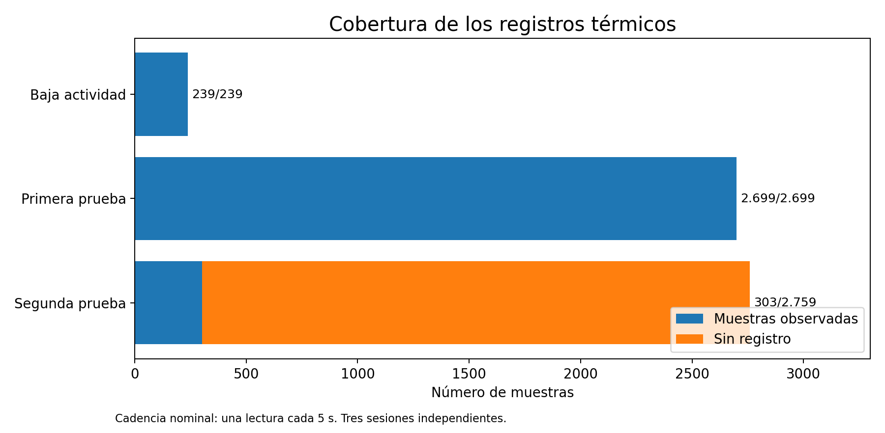

# 2. Cómo medir el calentamiento sin perder los cambios rápidos

[← Modelos](01-hardware-modelos.md) · [Índice](README.md) · [Siguiente: primera prueba →](03-primera-prueba.md)

## Dos formas de mirar la misma máquina

Un registrador tomaba una lectura térmica **cada cinco segundos**. La aplicación que ejecutaba la inferencia emitía además **controles puntuales** de temperatura y eventos de trabajo. Los eventos aportan contexto sobre qué tarea estaba activa; el registrador continuo muestra cómo cambia la temperatura entre esos instantes.

*Barras basadas en los recuentos de los resúmenes. La parte sin cubrir representa muestras planificadas y no registradas, **no** temperaturas supuestas.*

## Tres ventanas diferentes

| Observación | Cobertura de registro | Temperaturas observadas |
| --- | ---: | ---: |
| Baja actividad, sesión independiente | 239/239 | 26,284–28,719 °C |
| Primera prueba prolongada | 2.699/2.699 | 25,310–37,972 °C |
| Segunda prueba, adquisición interrumpida | 303/2.759 previstas | 26,771–38,946 °C |

Todos los resúmenes declaran `throttled=0x0` durante las muestras que cubrieron. **Eso no demuestra ausencia de eventos fuera de esas ventanas ni garantiza seguridad o estabilidad general.** La frecuencia de CPU disponible corresponde al núcleo 0 y `loadavg` no es utilización porcentual.

No disponemos aquí de ambiente, RPM, potencia eléctrica, presión efectiva de CPU ni confirmación del ventilador instalado en cada sesión. Los CSV y NDJSON originales no han podido recuperarse como bytes para cotejar sus SHA-256; se conserva ese límite antes de publicar inferencias detalladas.

[← Modelos](01-hardware-modelos.md) · [Índice](README.md) · [Siguiente: primera prueba →](03-primera-prueba.md)
