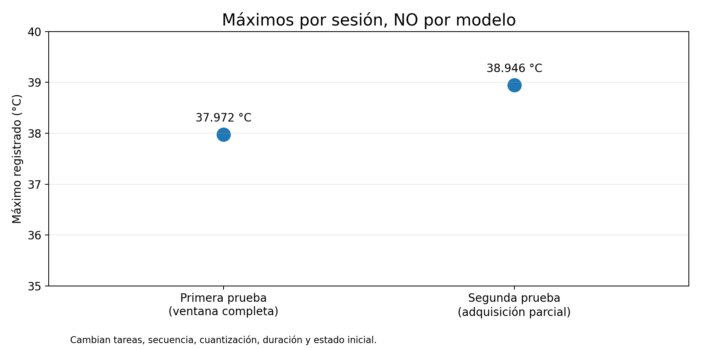
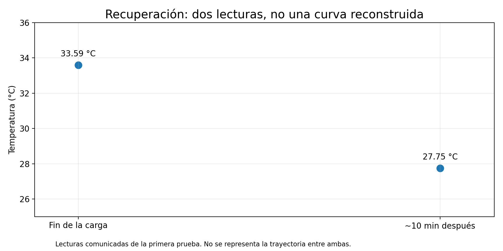

# 3. Primera prueba: calentamiento y recuperación

[← Método](02-como-medimos.md) · [Índice](README.md) · [Siguiente: segundo ensayo →](04-segunda-prueba.md)

Durante una sesión de casi **3 h y 45 min**, la Raspberry Pi ejecutó distintas tareas de inferencia. El registrador cubrió sus **2.699 muestras previstas** y observó un máximo de **37,972 °C**.

Esta cifra es el **máximo de toda la sesión de observación**, no un benchmark térmico de un modelo aislado. La continuidad sitúa ese pico dentro de una ventana de un modelo MiniCPM de la clase 2B, pero los datos no permiten atribuirle el calentamiento en exclusiva.

La temperatura acumulada también depende del trabajo previo, del entorno y del propio funcionamiento del sistema.

## ¿Y al terminar?

Tras la finalización de la carga se comunicó un descenso desde **33,589 °C hasta 27,745 °C** en unos diez minutos: una diferencia de **5,844 °C**.

*Los dos puntos proceden de la continuidad del laboratorio; los valores y el intervalo están pendientes de comprobación contra los CSV originales. No se dibuja una línea continua entre ellos.*

Es un resultado útil: además del calentamiento, la recuperación muestra cómo se libera calor cuando disminuye la carga. No permite calcular una constante térmica ni extrapolar tiempos de enfriamiento sin todas las muestras y las condiciones ambientales.

[← Método](02-como-medimos.md) · [Índice](README.md) · [Siguiente: segundo ensayo →](04-segunda-prueba.md)
