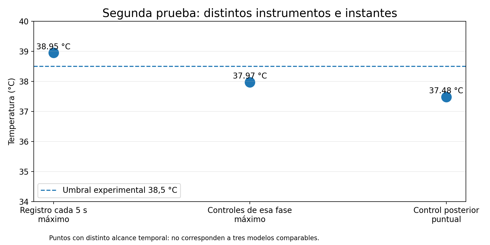
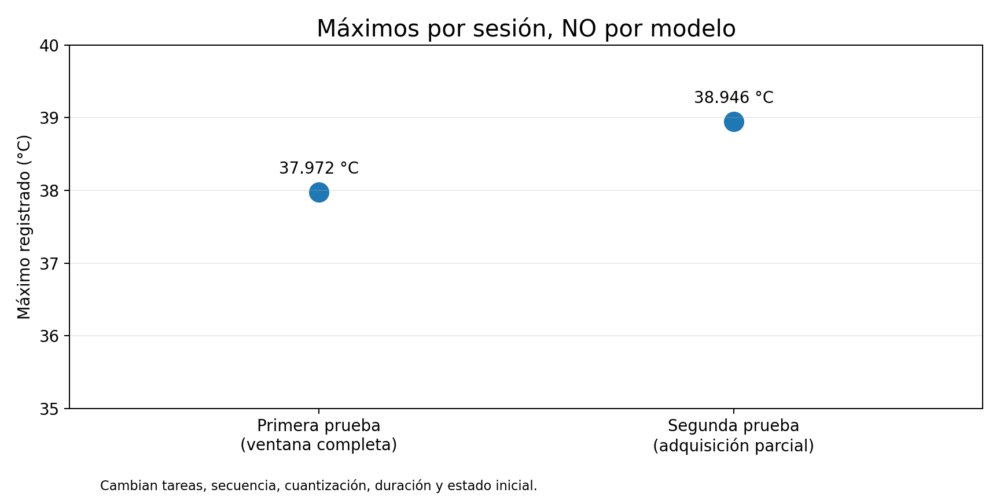

# 4. Segunda prueba: un pico que cambió la interpretación

[← Primera prueba](03-primera-prueba.md) · [Índice](README.md) · [Siguiente: ¿depende del modelo? →](05-modelos-y-temperatura.md)

La segunda sesión comenzó con una referencia térmica propia de aproximadamente **28,448 °C durante 7 min 29 s** antes de la carga. En la primera fase de inferencia, el registro pasó de su primera lectura superior a 30 °C a su primera lectura superior a 35 °C en **45 segundos** (según la continuidad del laboratorio; pendiente de contraste fila a fila).

Después ocurrió algo significativo:

- El registrador de cinco segundos observó un máximo de **38,946 °C**.
- Los **24 controles puntuales** asociados a aquella fase no superaron **37,97 °C**.
- Un control posterior al cierre del registrador indicó **37,48 °C**, alrededor de 15 s después.

**No eran tres modelos distintos:** eran lecturas de instrumentos y momentos diferentes. La disparidad muestra que una comprobación puntual puede omitir un extremo registrado por un muestreo frecuente.

## El registro acabó antes que el trabajo

El sistema de adquisición cerró al registrar 38,946 °C, tras **303 muestras**, con un criterio experimental de 38,5 °C. **Ese valor no es un límite térmico peligroso ni un umbral de fabricante.** El resumen reporta una razón de cierre genérica vinculada a temperatura o alimentación, por lo que el mecanismo exacto debe verificarse con los eventos originales.

El trabajo de IA continuó después, hasta completar **401 llamadas registradas** en toda la ejecución, pero las 303 muestras de temperatura **no** cubrieron las fases posteriores ni su recuperación. Esas llamadas no corresponden a 401 problemas independientes ni prueban estabilidad con repeticiones iguales.

La conclusión no es que los controles puntuales fueran incorrectos: **cada fuente observó algo distinto y la cobertura determina qué podemos afirmar**.

[← Primera prueba](03-primera-prueba.md) · [Índice](README.md) · [Siguiente: ¿depende del modelo? →](05-modelos-y-temperatura.md)
