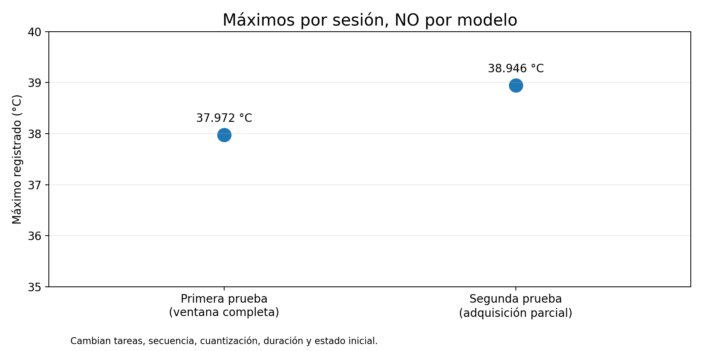
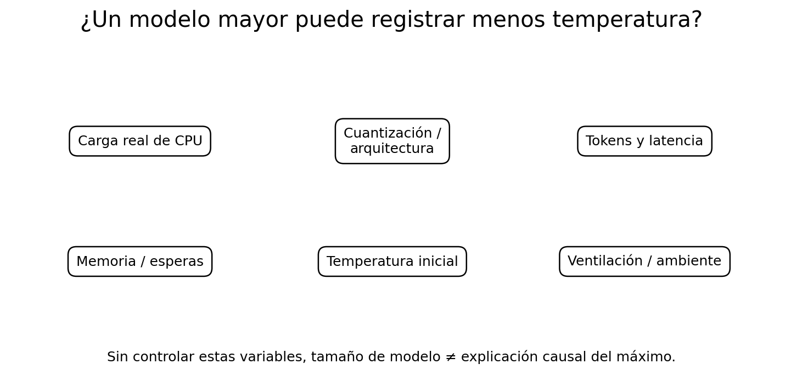

# 5. ¿Calienta más un modelo de IA por tener más parámetros?

[← Segunda prueba](04-segunda-prueba.md) · [Índice](README.md) · [Siguiente: conclusiones →](06-conclusiones.md)

## Primera pregunta: ¿hay diferencias de temperatura máxima entre modelos?

**Hay máximos diferentes en las sesiones observadas, pero no tenemos una comparación válida de máximos por tipo de modelo.** La primera prueba alcanzó 37,972 °C con cobertura completa y la segunda registró 38,946 °C antes de que se interrumpiera su adquisición. El pico de la primera coincidió temporalmente con una fase de MiniCPM de clase 2B; el aumento rápido de la segunda coincidió con una fase de Qwen3 de clase 0.6B. Son asociaciones de ventana de trabajo, no temperaturas atribuibles exclusivamente a cada modelo.

¿Por qué no sería riguroso construir ahora un ranking? Porque **varían al mismo tiempo** modelo, cuantización, formato, casos, duración, secuencia y calor acumulado; además, la segunda sesión no tuvo cobertura térmica hasta el final. No se conoce el máximo de cada modelo en condiciones comparables.

## Segunda pregunta: ¿puede un modelo mayor calentarse menos por ser más eficiente?

**Sí, es físicamente posible, pero estos experimentos no prueban que haya ocurrido.** Un modelo con más parámetros puede realizar un trabajo concreto con distinta actividad efectiva de CPU, gestión de memoria y duración. Además, el tamaño nominal no determina por sí solo el coste computacional por respuesta.

Las explicaciones plausibles incluyen:

- **Arquitectura y operaciones reales:** dos modelos de tamaño parecido pueden requerir cálculos diferentes por token; no basta comparar parámetros.
- **Cuantización y ejecución:** formato de pesos, kernels y compatibilidad con CPU afectan a las operaciones y la memoria transferida.
- **Prefill, generación y espera:** la carga puede alternar cómputo intenso, accesos a memoria y periodos de baja actividad. Una inferencia lenta no significa necesariamente CPU ocupada al 100 %.
- **Duración y calor heredado:** un máximo puede ser menor porque el trabajo dura menos, porque comienza con la placa más fría o porque la ventilación y el ambiente son distintos.
- **Frecuencia dinámica:** la CPU puede variar su frecuencia; disponer sólo de la del núcleo 0 no permite reconstruir la ocupación de todos los núcleos.

**Menor temperatura máxima no equivale a mayor eficiencia energética.** Para hablar de eficiencia necesitamos definir trabajo útil y medir potencia y energía (W, J o Wh), idealmente energía por trabajo terminado, no sólo grados Celsius.

La siguiente prueba deberá fijar tarea, tamaño de entrada, presupuesto de salida, estado térmico inicial y orden de ejecución; después repetir cada condición varias veces.

[← Segunda prueba](04-segunda-prueba.md) · [Índice](README.md) · [Siguiente: conclusiones →](06-conclusiones.md)
