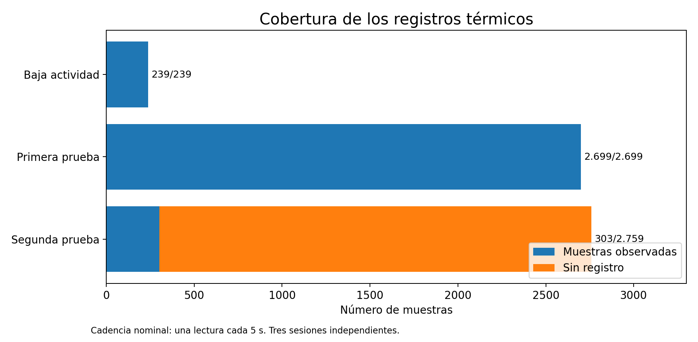
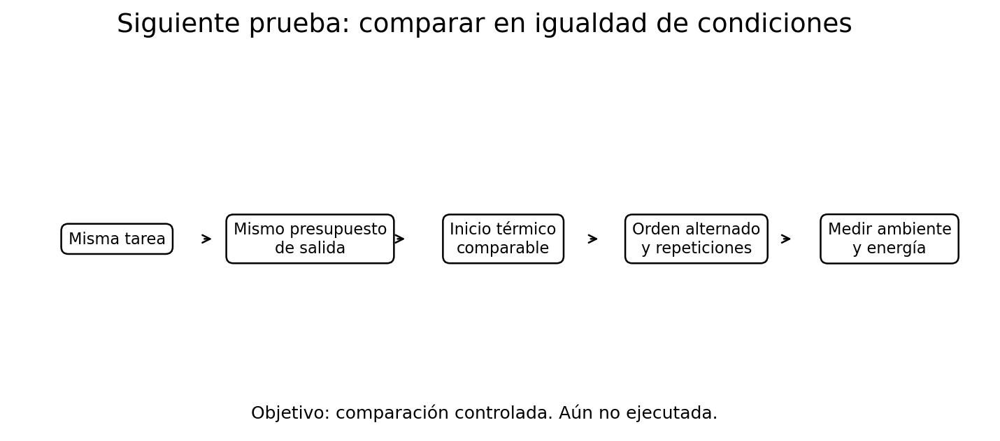

# 6. Qué aprendimos y qué queda por comprobar

[← Modelos y temperatura](05-modelos-y-temperatura.md) · [Índice](README.md)

## En cinco ideas

1. **Una Raspberry Pi 4B puede ejecutar modelos pequeños de lenguaje usando CPU**, sin una GPU dedicada a inferencia.
2. **Los máximos térmicos cambiaron entre sesiones**, pero no son temperaturas comparables por modelo: las condiciones y la cobertura fueron diferentes.
3. **La recuperación importa:** después de terminar una carga se comunicó un descenso de unos 5,8 °C en diez minutos.
4. **La frecuencia de medición importa:** los registros cada cinco segundos y los controles puntuales no encontraron el mismo máximo en la segunda prueba.
5. **Si el registro se detiene antes que el trabajo, perdemos información:** no podemos reconstruir la temperatura posterior con unas pocas lecturas aisladas.

## Qué haríamos distinto en el próximo ensayo

La siguiente etapa será un experimento distinto: **misma tarea y presupuesto de salida, repeticiones, orden de modelos alternado, temperatura inicial comparable y ambiente medido**. Separaremos el aviso por temperatura del mecanismo de parada de la carga, manteniendo una protección independiente verificada. No se propone elevar el umbral de registro como solución inmediata.

Si podemos medir potencia eléctrica, diferenciaremos **potencia instantánea (W), energía total (J/Wh) y energía por trabajo útil completado**. Esto permitirá estudiar eficiencia en lugar de interpretarla a partir de la temperatura.

## Dos preguntas para reproducirlo

**¿Qué intervalo de muestreo utilizas para detectar picos de temperatura breves en un ordenador pequeño?**

**¿Cómo igualas la temperatura inicial y el calor acumulado cuando comparas distintos modelos?**

Si tienes mediciones comparables, una propuesta de protocolo o una crítica, puedes [abrir una discusión mediante GitHub Issues](https://github.com/fdominguezr/ai-systems-learning-lab/issues/new) y compartir los resultados y condiciones, sin publicar rutas privadas ni credenciales.

[← Modelos y temperatura](05-modelos-y-temperatura.md) · [Índice](README.md)
