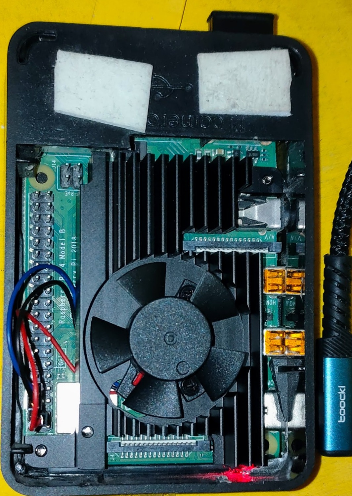
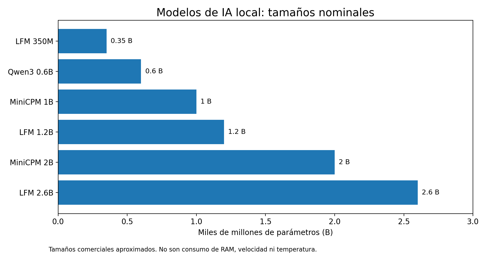

# ¿Cuánto se calienta una Raspberry Pi ejecutando IA?

*Lo que descubrimos al medirla cada cinco segundos.*

**Un pico inesperado, una recuperación térmica y una lección sobre lo que nuestros instrumentos pueden —y no pueden— demostrar.**

Una Raspberry Pi 4B puede ejecutar modelos de lenguaje localmente sin una GPU dedicada. Pero, ¿cómo responde su temperatura cuando se mantiene trabajando durante horas? Para averiguarlo registramos la temperatura durante tres observaciones: una con baja actividad y dos con cargas de inferencia de distinta duración.

*Fotografía de octubre de **2026**: Raspberry Pi 4B con el módulo de enfriamiento actual, montado sobre el disipador principal dentro de la carcasa. Pertenece a la etapa de trabajo actual, pero no permite acreditar por sí sola la configuración exacta de ventilación durante cada medición térmica.*

## Lee la serie

| Página | Qué encontrarás |
| --- | --- |
| [1. Hardware y modelos](01-hardware-modelos.md) | Cómo puede correr LLMs una Raspberry Pi y qué tamaños probamos |
| [2. Cómo medimos](02-como-medimos.md) | Registro cada 5 s, controles puntuales y cobertura real |
| [3. Primera prueba](03-primera-prueba.md) | Calentamiento sostenido y recuperación posterior |
| [4. Segunda prueba](04-segunda-prueba.md) | El pico inesperado y la diferencia entre instrumentos |
| [5. Modelos y temperatura](05-modelos-y-temperatura.md) | Qué se puede y qué no se puede inferir por tamaño de modelo |
| [6. Qué aprendimos](06-conclusiones.md) | Conclusiones, límites y siguiente experimento |

*Los parámetros muestran el tamaño nominal del modelo; no equivalen a temperatura, velocidad ni memoria real utilizada.*

## Contexto de la serie

Esta pieza continúa la línea abierta en [Raspberry Pi 4 + Noctua: montaje, alimentación y acústica](../raspberry-pi-noctua-phase1/README.md), pero aquí el foco pasa de la refrigeración y el ruido a la **carga real de inferencia local**.

**Alcance de esta publicación:** análisis exploratorio, no benchmark controlado. Las figuras publicadas respetan la cobertura disponible y no inventan curvas continuas cuando faltan muestras originales.

[Siguiente: hardware y modelos →](01-hardware-modelos.md)
