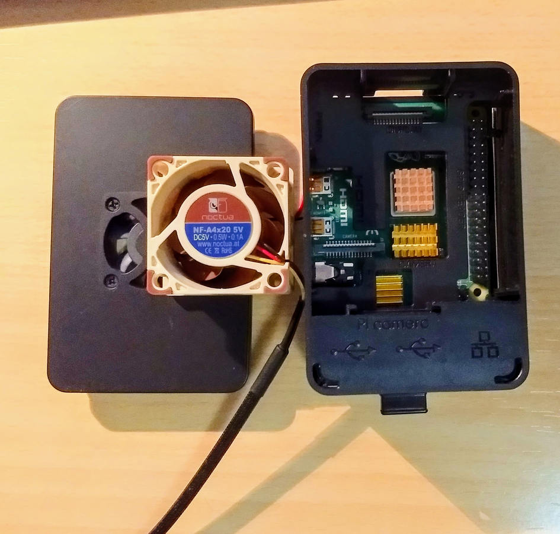

# Raspberry Pi 4 + Noctua: refrigeración, montaje y ruido

**Una investigación práctica en varias etapas, no una comparación comercial de ventiladores.**

Una Raspberry Pi 4 puede funcionar durante periodos prolongados, pero la temperatura, la alimentación, el montaje del ventilador y el ruido percibido plantean problemas diferentes. En esta serie documentamos lo observado, distinguimos lo medido de lo reportado y explicamos qué se puede reproducir sin manipular el hardware.

*Imagen histórica de mayo de 2020. Tapa adaptada y carcasa abierta; no es una medición de 2026.*

> **Dos épocas, dos objetivos:** el prototipo Noctua se fotografió en **mayo de 2020**. Las observaciones térmicas y grabaciones acústicas descritas posteriormente pertenecen a **octubre–noviembre de 2026**. Las imágenes de la alternativa Scythe son de octubre de 2026. No son una única campaña experimental.

## Empieza por aquí

| Página | Qué encontrarás |
| --- | --- |
| [1. Montaje del prototipo](montaje.md) | Ventilador, adaptación mecánica y límites de la documentación |
| [2. Alimentación y temperatura](temperatura.md) | Prueba histórica de 10 minutos, subtensión y registro F3 pendiente |
| [3. El ruido y su espectro](acustica.md) | Tres audios reanalizados, tabla de frecuencias y límites de interpretación |
| [4. Una alternativa: Scythe](alternativa-scythe.md) | Diferencias de etapa y análisis geométrico, sin atribuir pruebas no hechas |
| [5. Cómo investigar tu propia Raspberry Pi](reproducir.md) | Recopilar observaciones básicas sin modificar el sistema |
| [6. Galería ampliada](fotografias.md) | 12 imágenes: seis fotos del Noctua, cuatro del Scythe, una gráfica espectral y una captura de la app |

## Tres cosas que aprendimos

**1. Alimentación y temperatura no son lo mismo.** Una subtensión afecta la interpretación de cualquier prueba térmica. Antes de atribuir un problema al ventilador, hay que documentar la fuente utilizada y el estado de throttling.

**2. Una frecuencia acústica no equivale a revoluciones por minuto ni a decibelios.** En tres grabaciones aparecieron bandas periódicas compatibles con armónicos, pero sin una medición acústica calibrada ni identificación causal.

**3. El espacio disponible también es una especificación.** Un ventilador o disipador puede ser adecuado sobre el papel y exigir adaptadores, tapas o fijaciones difíciles de integrar.

## Resultados y límites, de un vistazo

| Elemento | Qué consta | Qué no está demostrado |
| --- | --- | --- |
| Prototipo 2020 | Noctua NF-A4x20 5V, tres hilos, tapa adaptada | Esquema eléctrico reproducible, PWM continuo |
| Ensayo térmico histórico | Máxima **reportada** de 51,6 °C en 10 min bajo carga con la fuente original | Repetición independiente actual; generalización a otros entornos |
| Registro F3 | Existió una referencia a siete días de observación | Log primario recuperado y auditado |
| Acústica | Picos espectrales reanalizados de tres audios | SPL calibrado, dB(A), RPM ni componente causante |
| Material visual | 12 JPG únicos: 6 fotos Noctua (2020), 4 fotos Scythe (2026), 1 gráfica derivada y 1 captura de app | La repetición de una foto entre capítulos no añade archivos ni certifica resultados técnicos |

## ¿Qué investigarías después?

¿Empezarías por alimentación, refrigeración, transmisión de vibraciones o espectro acústico? Los capítulos incluyen preguntas para continuar el experimento. Si puedes reproducir una observación o cuestionar el protocolo, [abre una issue](https://github.com/fdominguezr/ai-systems-learning-lab/issues/new) indicando condiciones y resultados, no sólo impresiones.

## Alcance de esta edición

Publicamos explicación técnica, navegación y **12 imágenes únicas (10 fotografías reales, una gráfica derivada del análisis acústico y una captura seleccionada de la app)** del material aportado por el titular o de su análisis. Los JPG publicados están optimizados sin EXIF; la captura de la app se ha recortado para ocultar la barra de estado del móvil. **No publicamos** audios originales, datos brutos, otras capturas de la investigación, direcciones internas ni documentación operativa. La única captura de aplicación pública está seleccionada y recortada. Las fotos ilustran el montaje de 2020 y la alternativa estudiada en 2026; no constituyen mediciones de rendimiento.

**Fuentes externas:** [Documentación oficial de Raspberry Pi](https://www.raspberrypi.com/documentation/computers/os.html) · [Especificaciones de Noctua NF-A4x20 5V](https://www.noctua.at/en/products/nf-a4x20-5v/specifications).

**Reutilización:** la licencia de contenidos existente en la raíz del repositorio identifica expresamente otras obras; no se presume que cubra este artículo ni futuras imágenes. [Ver aviso de licencia](../../CONTENT_LICENSE.md).
