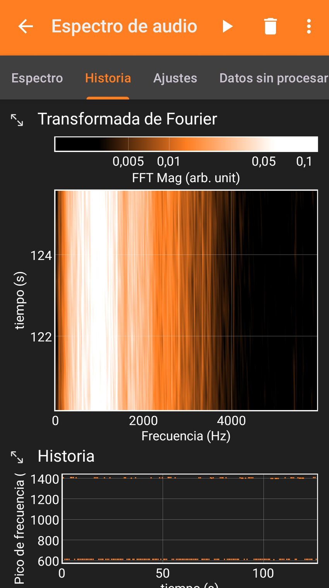
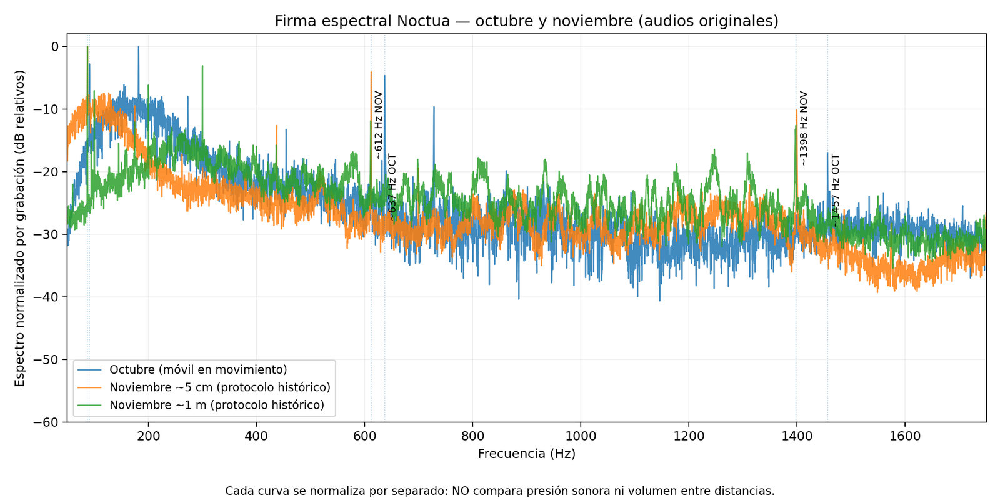

# 3. ¿Por qué se oye el ventilador? Lo que muestra el espectro

[← Temperatura](temperatura.md) · [Índice](README.md) · [Siguiente: Scythe →](alternativa-scythe.md)

## Escuchar no es medir presión sonora

Una grabación con móvil puede servir para detectar periodicidades, armónicos o cambios en la firma acústica. No sustituye un sonómetro calibrado: por sí sola no informa de dB(A) ni de potencia sonora absoluta.

Se reanalizaron **tres audios originales** en el trabajo anterior: una grabación de octubre con desplazamiento aproximado del micrófono de 1 m a 1 cm y regreso, y dos grabaciones de noviembre históricamente atribuidas a distancias próximas a 5 cm y 1 m. Las distancias son atribuciones de la sesión, **no mediciones extraídas del sonido**.

## Método comunicado

El reanálisis utilizó ventanas **Hann de 4 segundos**, **50 % de solapamiento** y **mediana de espectros**. Estos parámetros permiten comparar concentraciones de energía frecuencial de los archivos examinados; la interpretación depende también del micrófono, el entorno y el segmento grabado.

### Exploración con una aplicación de espectro

*Captura exploratoria de noviembre de 2026 recortada para eliminar la barra de estado del teléfono. Visualiza la evolución de los picos, pero no es una medición SPL calibrada ni debe confundirse con el procesamiento agregado de los audios.*

## Frecuencias destacadas

| Grabación | Banda baja | Banda ~7× | Banda ~16× |
| --- | ---: | ---: | ---: |
| Octubre | **91,00 Hz** | 637,25 Hz | 1.456,50 Hz |
| Noviembre, cercano* | **87,50 Hz** | 612,25 Hz | 1.399,50 Hz |
| Noviembre, lejano* | **87,25 Hz** | 611,25 Hz | 1.397,75 Hz |

*Distancia atribuida históricamente, no inferida del audio.*

*Figura derivada del reanálisis de los audios originales. Cada curva está normalizada por separado: no permite comparar dB(A) ni volumen entre distancias.*

Estas bandas son **compatibles con un patrón periódico y armónicos**; su proximidad no certifica que procedan del rotor, de un componente eléctrico, de una resonancia estructural o de una combinación de fuentes.

## Tres inferencias que deben evitarse

1. **Frecuencia = RPM:** no se conoce el vínculo mecánico exacto entre un pico y cada giro.
2. **Pico = origen identificado:** un armónico puede propagarse o amplificarse por la estructura.
3. **Más alto en la FFT = más dB(A):** faltan calibración, ponderación y un protocolo SPL comparable.

No existe aquí una comparación acústica equivalente, controlada y calibrada entre Noctua y el ventilador posterior Armor Lite.

## Qué faltaría para un experimento comparativo

Mismo emplazamiento, misma carga y alimentación, distancias medidas, ambiente documentado, captación calibrada y repetición suficiente. Son **requisitos recomendados**, no resultados ejecutados.

Los audios originales, los archivos de trabajo y el resto de capturas **se mantienen fuera del repositorio público**. Aquí se incluyen únicamente dos figuras seleccionadas para explicar el método y sus límites.

## Preguntas para investigar

- ¿Qué procedimiento te permitiría distinguir la frecuencia fundamental de una resonancia de la carcasa, sin inferir RPM directamente?
- ¿Cómo compararías dos ventiladores con una misma carga y distancia sin confundir FFT exploratoria con presión sonora calibrada?
- ¿Has observado picos acústicos inesperados en ventiladores, fuentes de alimentación o carcasas?

[Comparte un protocolo o una contraprueba en una issue](https://github.com/fdominguezr/ai-systems-learning-lab/issues/new).

[← Temperatura](temperatura.md) · [Índice](README.md) · [Siguiente: Scythe →](alternativa-scythe.md)
