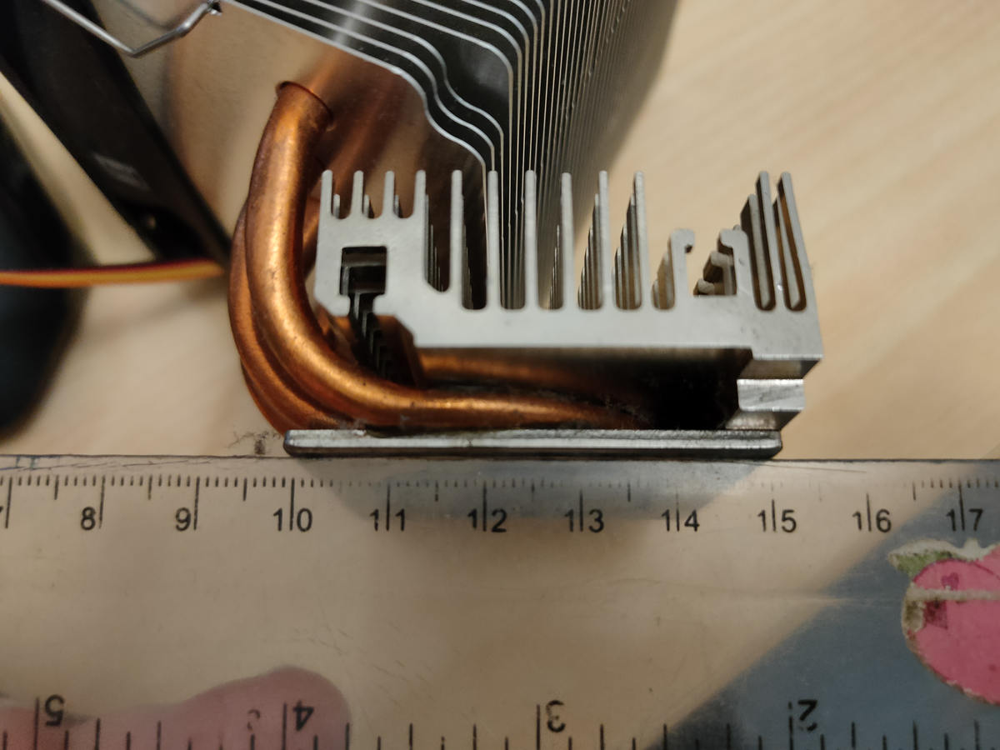
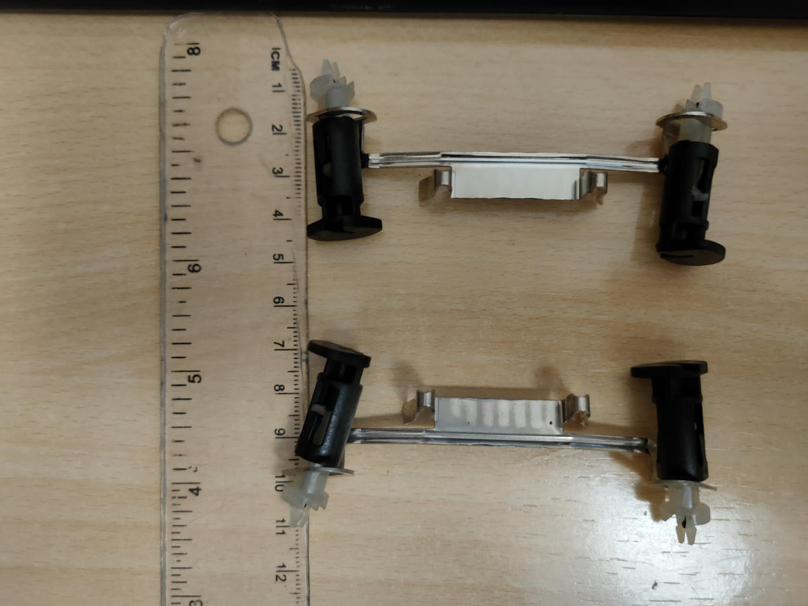

# 4. La alternativa Scythe: cuando la geometría manda

[← Acústica](acustica.md) · [Índice](README.md) · [Siguiente: guía práctica →](reproducir.md)

## Una comparación que no debe confundirse

El prototipo **Noctua** mostrado en el archivo fotográfico corresponde a **mayo de 2020**. Las imágenes del disipador alternativo **Scythe**, con regla y piezas de fijación, corresponden a **octubre de 2026**. No son fotografías de una sustitución realizada dentro de la misma prueba térmica o acústica.

## ¿Qué se estaba evaluando?

La viabilidad mecánica de un disipador mayor, con heatpipes, aletas y herrajes de montaje. Sobre una placa compacta, la cuestión no es sólo la temperatura nominal esperada: el conjunto debe caber, sujetarse sin interferencias y permitir una integración segura.

### Aspectos que ilustran las dos vistas documentadas

- **Disipador y regla:** el volumen físico y las posibles interferencias con la carcasa o componentes.
- **Herrajes y regla:** la cantidad de piezas, posiciones relativas y dificultad de fijación.

No se dispone en esta publicación de una tabla de dimensiones verificadas ni de un ensayo térmico equivalente de la alternativa. Por tanto, **no se declara vencedor** entre Noctua y Scythe.

## La decisión técnica detrás de una foto

Una imagen con escala puede mostrar un impedimento físico y justificar continuar o abandonar un diseño. Pero una fotografía no reemplaza tolerancias medidas, ensayos de montaje o una verificación térmica y mecánica.

*Octubre de 2026: perfil del disipador alternativo junto a una regla, útil para evaluar ocupación mecánica.*

*Octubre de 2026: piezas de fijación y escala; la imagen no demuestra compatibilidad final ni mejora térmica.*

[Ver el archivo fotográfico completo](fotografias.md).

[← Acústica](acustica.md) · [Índice](README.md) · [Siguiente: guía práctica →](reproducir.md)
