# 6. Galería ampliada — fotografías y análisis de Noctua y Scythe

[← Guía práctica](reproducir.md) · [Índice](README.md)

**Diez fotografías auténticas y dos imágenes de análisis acústico (12 imágenes en total)**, seleccionadas del material aportado por el autor o derivadas de los análisis originales, optimizadas para GitHub. Los archivos publicados se guardan en [`images/`](images/) y no contienen EXIF. La revisión visual final del lector/autor aún puede detectar correcciones editoriales.

**Cronología:** las fotografías 01–06 son del montaje Noctua de mayo de 2020; 07–08 y 11–12 documentan la alternativa Scythe de octubre de 2026. Las imágenes 09–10 corresponden al análisis acústico de octubre–noviembre de 2026, no al montaje de 2020.

## Prototipo Noctua — mayo de 2020

### 01. Carcasa y tapa abiertas

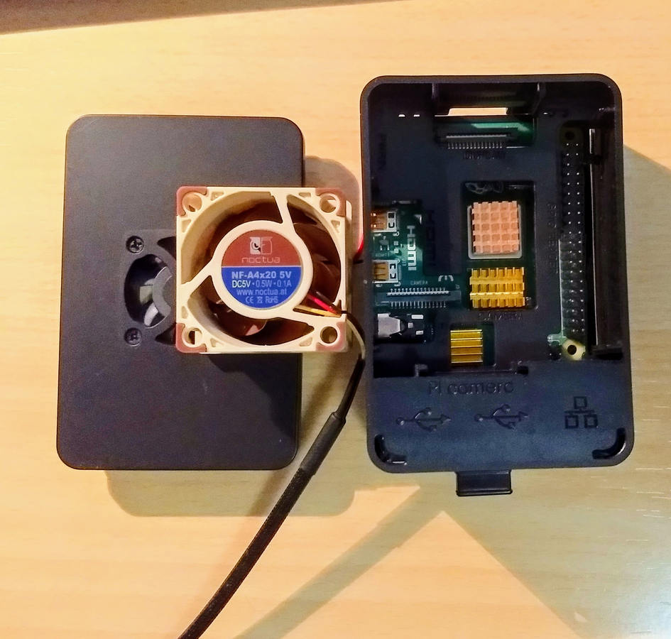

*Carcasa de Raspberry Pi 4 con disipadores y tapa exterior con el ventilador Noctua; archivo de mayo de 2020*

### 02. Interior del adaptador

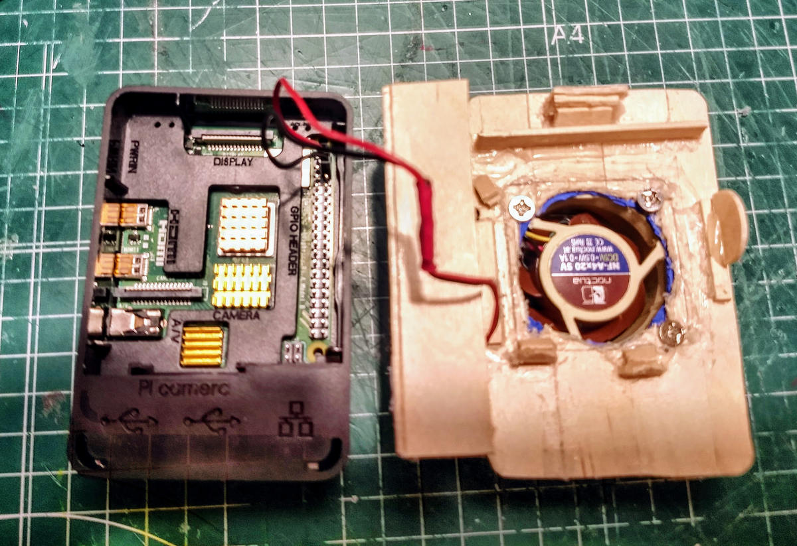

*Tapa artesanal de madera con cableado y ventilador Noctua frente a la carcasa abierta; mayo de 2020*

### 03. Perfil lateral

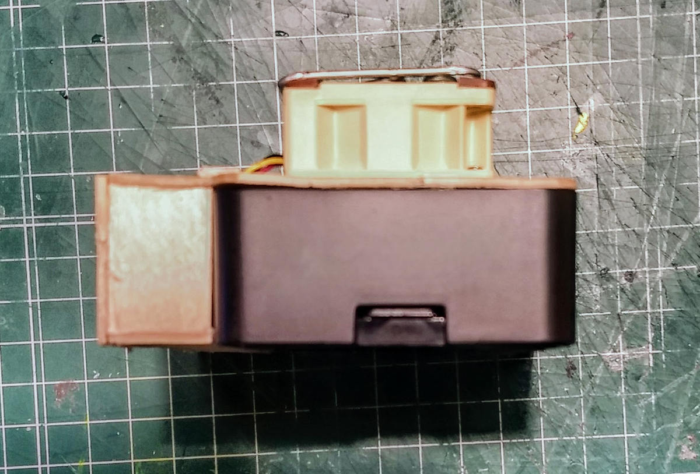

*Vista lateral de la adaptación y el ventilador sobresaliente; mayo de 2020*

### 04. Montaje externo

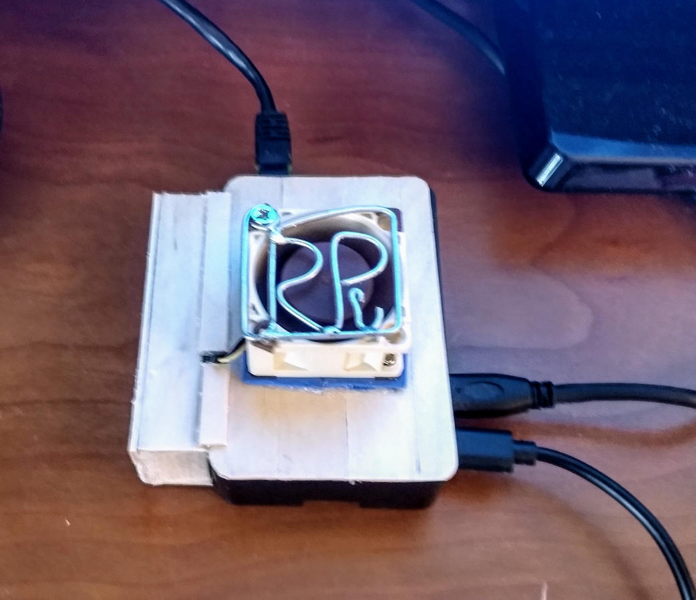

*Tapa instalada y conectada sobre mesa de trabajo; fotografía de 2020, no toma acústica de 2026*

### 05. Ventilador antes de integrar

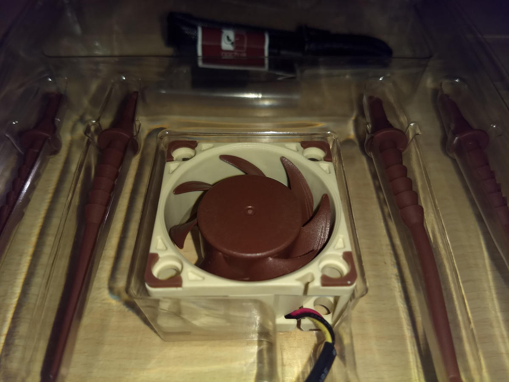

*Detalle del Noctua en su embalaje; mayo de 2020*

### 06. Kit y prototipo

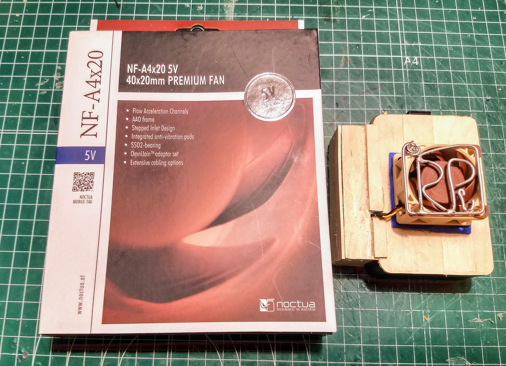

*Caja Noctua y prototipo con tapa adaptada; mayo de 2020*

## Alternativa Scythe — octubre de 2026

### 07. Scythe con regla

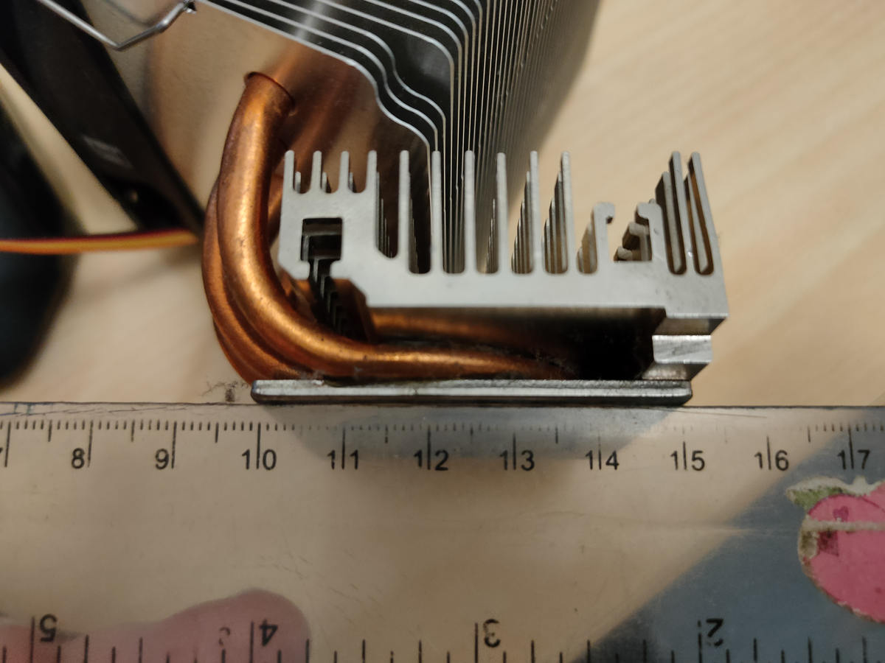

*Heatpipes y aletas de disipador alternativo con escala; octubre de 2026*

### 08. Fijaciones Scythe

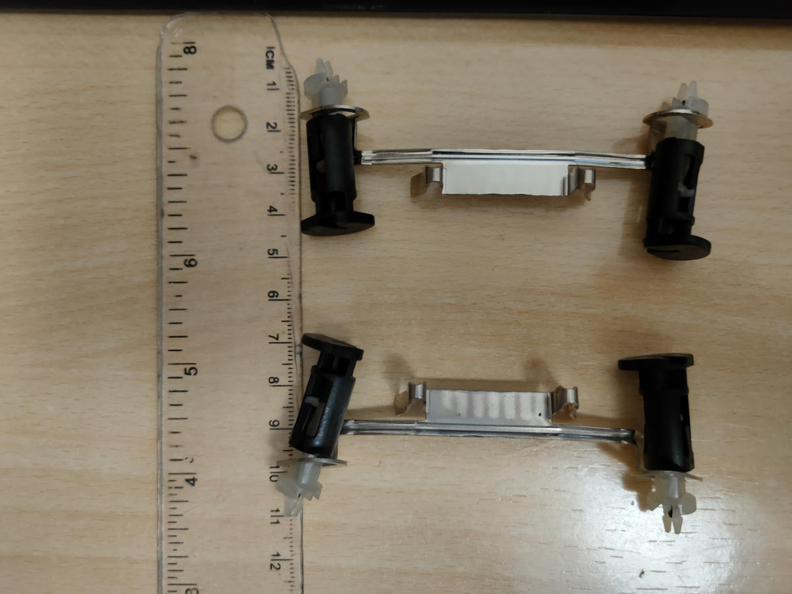

*Piezas metálicas de sujeción con regla; octubre de 2026*

## Figuras y fotografías añadidas

### 09. Comparación espectral

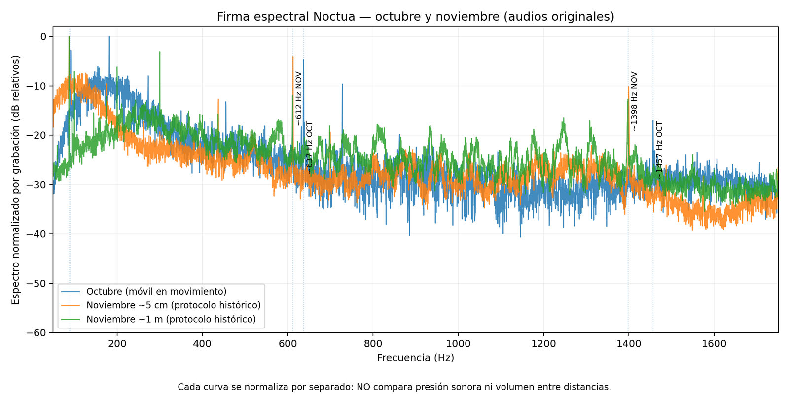

*Figura de reanálisis, con normalización separada. No representa presión sonora calibrada.*

### 10. Espectro e historial en la aplicación

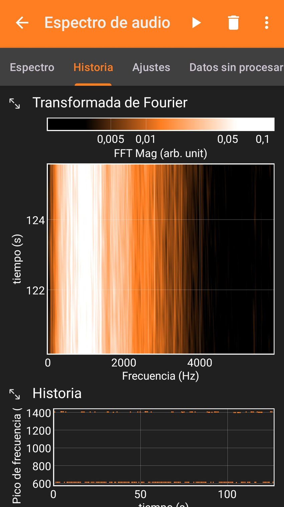

*Captura exploratoria de noviembre de 2026, sin la barra superior del teléfono ni audios originales.*

### 11. Scythe junto a Raspberry Pi 4

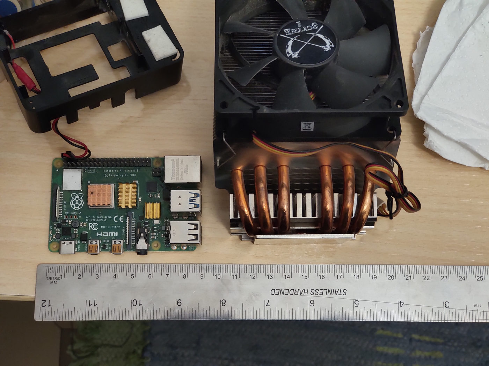

*Octubre de 2026: comparación física directa sin instalar el disipador.*

### 12. Vista completa de Scythe

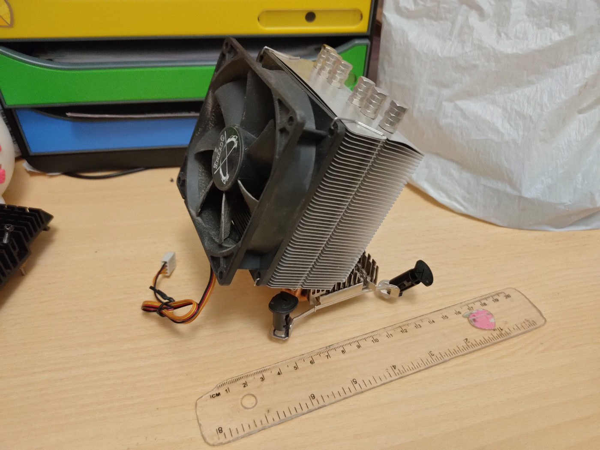

*Octubre de 2026: ventilador y estructura completos.*

## Procedencia y límites

Se conservaron nombres de origen y hashes en el inventario de preparación, sin subir a la documentación pública nombres completos de directorios personales, EXIF, audios ni capturas de aplicaciones. Las fotografías documentan geometría y montaje; las imágenes acústicas ilustran frecuencias relativas. Ninguna prueba eficacia térmica, dB(A), RPM ni parámetros eléctricos. **La publicación de estas versiones JPG no crea por sí sola una licencia de reutilización de las fotografías**.

[← Guía práctica](reproducir.md) · [Índice](README.md)
