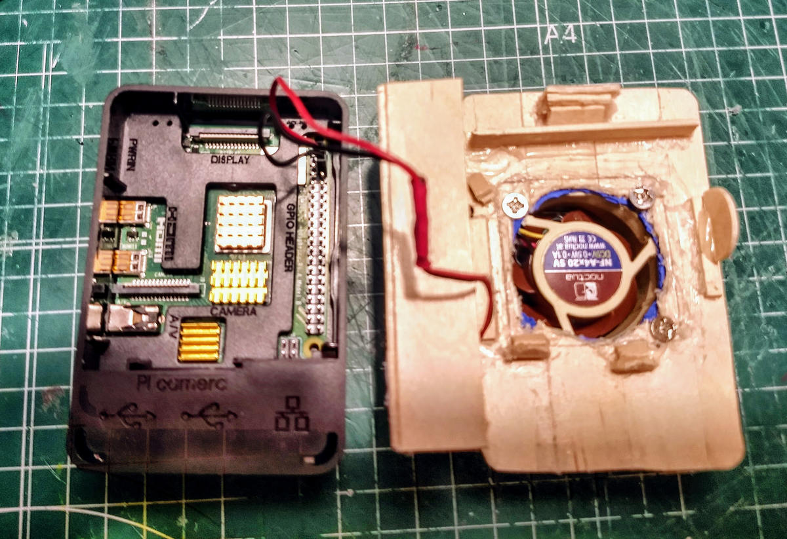
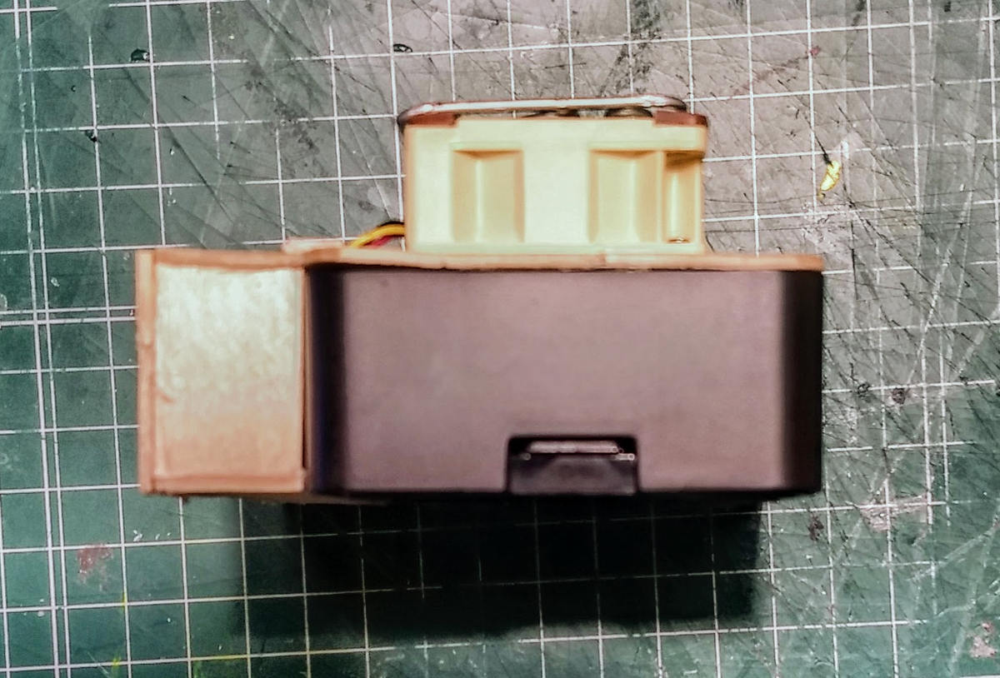
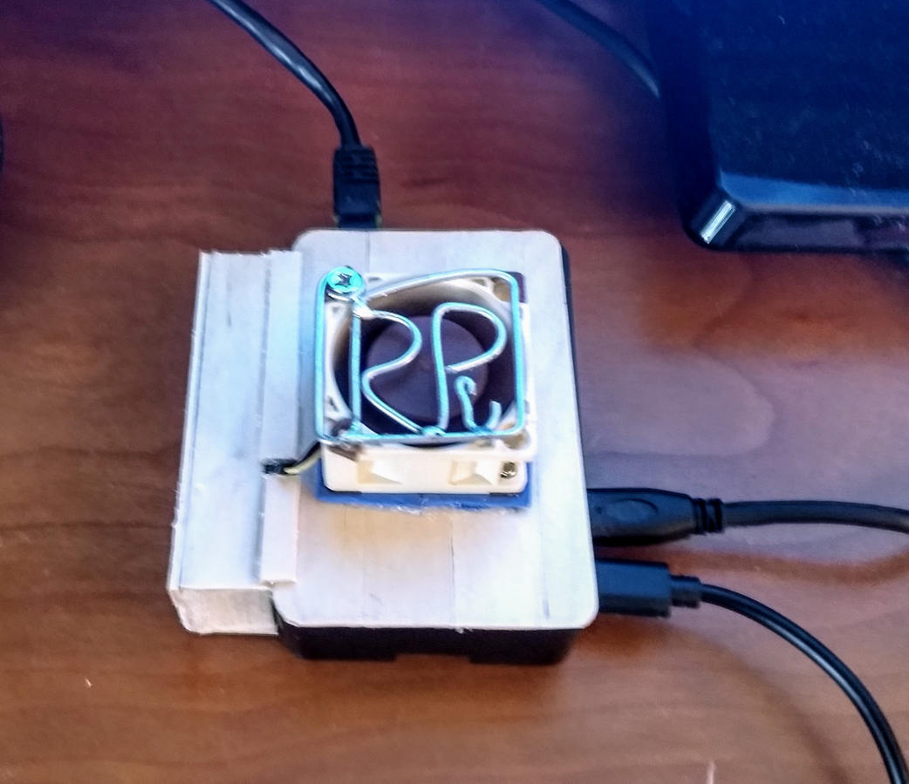
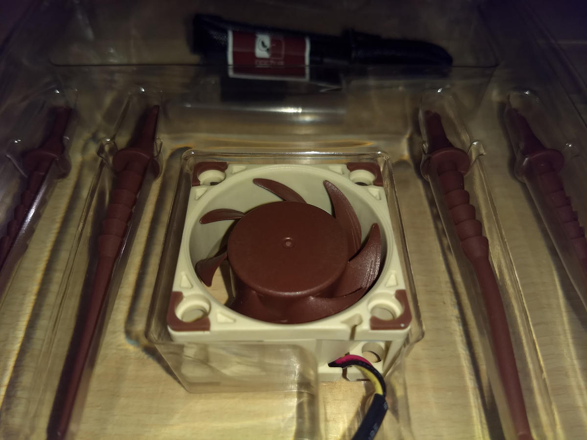
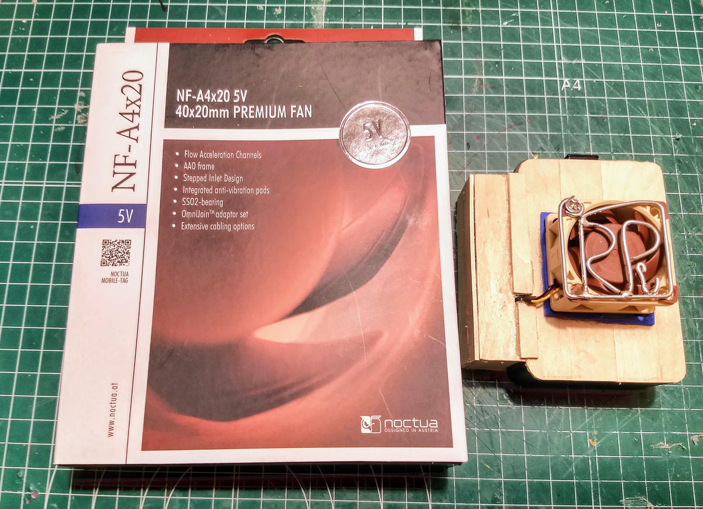

# 1. El montaje original: Raspberry Pi 4 + Noctua

[← Índice](README.md) · [Siguiente: temperatura →](temperatura.md)

## ¿Qué se pretendía resolver?

El prototipo histórico trataba de integrar un ventilador pequeño en una carcasa de Raspberry Pi 4, junto con disipadores de cobre, sin perder de vista la ocupación de espacio y la posibilidad de ruido. Fue un montaje artesanal, no un producto terminado ni un diseño eléctrico certificado.

## Componentes documentados

- **Raspberry Pi 4**, con carcasa y disipadores de cobre.
- **Noctua NF-A4x20 5V, de tres hilos**.
- **Tapa adaptada** y una pieza de madera empleada como soporte o adaptación del ventilador, según el registro fotográfico histórico descrito.
- Alimentación evaluada en una fase posterior, separada de las fotografías de 2020.

La forma de fijar un ventilador no es un detalle menor: influye en la altura total, el paso del aire, la accesibilidad y las posibles vibraciones. Sin una cota completa de la carcasa y una medición del caudal real, no se puede deducir una mejora cuantitativa del diseño.

## Tres hilos no significan cuatro hilos PWM

En un ventilador de tres hilos normalmente se distinguen alimentación, retorno y señal de tacómetro. La señal de tacómetro **no** debe describirse como una entrada específica de control PWM de cuatro hilos. En esta etapa no se demostró control PWM continuo del Noctua.

Tampoco se publica aquí una guía de conexión GPIO ni una alimentación eléctrica del ventilador paso a paso: faltan los datos primarios suficientes para reproducir el circuito con garantías.

## Qué documenta el archivo fotográfico

El inventario histórico incluye una vista de tapa abierta, interior de la adaptación, perfil lateral, montaje sobre mesa, primer plano y conjunto del prototipo. A continuación se muestran las fotografías **reales de mayo de 2020**, sin interpretarlas como mediciones acústicas de 2026.

*Interior de la adaptación de madera. Fotografía de montaje histórico, no esquema eléctrico reproducible.*

*Vista lateral: la altura del ventilador condiciona el espacio disponible.*

*Montaje sobre la mesa de trabajo en 2020; **no** pertenece a las grabaciones acústicas de 2026.*

*Detalle del componente antes de integrarlo.*

*Producto comercial y prototipo a escala contextual. La fotografía no representa una medida dimensional calibrada.*

[Ver la galería completa y su cronología](fotografias.md).

## Qué habría que medir para convertirlo en diseño reproducible

Dimensiones del adaptador, posición exacta del ventilador, fijaciones, conexión eléctrica, dirección de flujo, condiciones de alimentación, temperatura ambiente y protocolo de comparación. **No son mediciones realizadas en esta edición**; son el conjunto mínimo de datos pendiente para una reproducción controlada.

[← Índice](README.md) · [Siguiente: temperatura →](temperatura.md)
