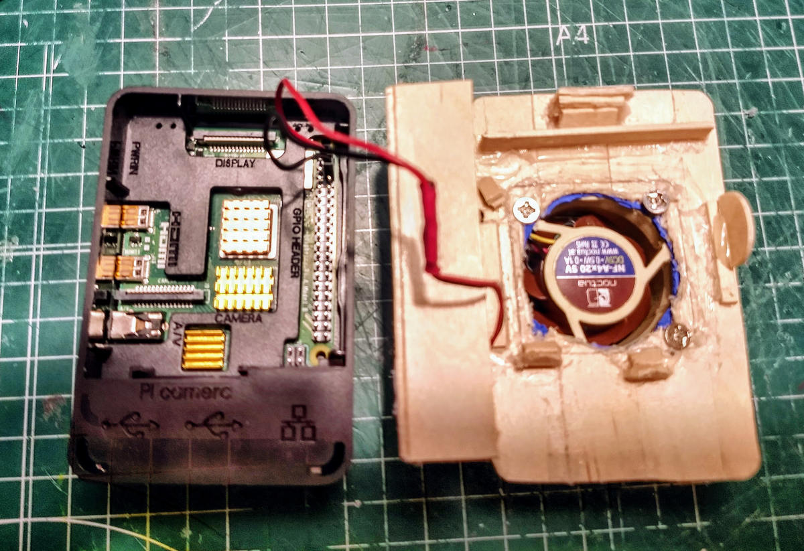

# 2. Alimentación y temperatura: antes de sacar conclusiones

[← Montaje](montaje.md) · [Índice](README.md) · [Siguiente: acústica →](acustica.md)

## El primer problema: la subtensión

En las pruebas históricas se comunicaron episodios de subtensión con una fuente alternativa. Eso obliga a separar la calidad de alimentación de la eficacia del refrigerador: si la placa reduce rendimiento por alimentación, una temperatura menor por sí sola puede conducir a una interpretación equivocada.

## La observación térmica reportada

Con la fuente original se comunicó una prueba bajo carga de **10 minutos**, con temperatura máxima **reportada de 51,6 °C** y sin throttling en las muestras mencionadas.

| Variable | Estado de evidencia |
| --- | --- |
| Duración | 10 minutos, según registro histórico |
| Fuente | Original, según registro histórico |
| Temperatura máxima | 51,6 °C, **reportada**, no revalidada aquí |
| Throttling | No observado en las muestras comunicadas |
| Temperatura ambiente y protocolo completo | No recuperados para esta publicación |
| Repetición independiente | No realizada aquí |

*Fotografía del prototipo de mayo de 2020. Ilustra la integración mecánica y el cableado, pero no muestra la prueba térmica de 2026 ni acredita un esquema eléctrico reproducible.*

**Interpretación acotada:** este dato es una observación histórica en condiciones parciales. No demuestra una ventaja frente a otro ventilador ni permite extrapolar a una Raspberry Pi distinta.

## ¿Y el registro de siete días?

El baseline denominado **F3**, referido como una observación de siete días, continúa **sin log primario disponible** para revisión. No se presentan aquí series temporales, medias, percentiles ni garantías de funcionamiento continuo derivadas de F3.

La diferencia importa: *duración comunicada* no equivale a *dataset recuperado*, y este último tampoco implica una *medición auditada* si no se comprueban trazabilidad, configuración e integridad.

## Cómo separar las variables

Para estudiar refrigeración conviene registrar simultáneamente versión de placa, fuente, temperatura, estado de throttling, carga, condiciones ambientales y posición del conjunto. Primero hay que obtener una línea base estable; después se modifica **una condición cada vez** y se comparan resultados.

La guía [Cómo investigar tu Raspberry Pi](reproducir.md) incluye comandos de observación, sin actuar sobre ventiladores ni GPIO.

## Preguntas para investigar

- ¿Cómo separarías experimentalmente el efecto de la fuente de alimentación y el del ventilador?
- ¿Qué compararías primero: un ensayo breve con carga controlada o una observación prolongada con temperatura ambiente registrada?
- ¿Has detectado subtensión o cambios térmicos al sustituir sólo la fuente o la carcasa?

[Comparte una experiencia o propone una contraprueba en una issue](https://github.com/fdominguezr/ai-systems-learning-lab/issues/new), sin incluir información privada.

[← Montaje](montaje.md) · [Índice](README.md) · [Siguiente: acústica →](acustica.md)
